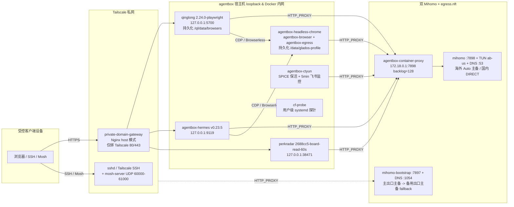

# `agentbox` 全栈重构、加固与运维手册（2026-11）

本文记录 `agentbox`（无公网 IP 云主机，Debian 13，Tailscale 接入）在 2026-11-28 完成的代理架构收敛、系统底座加固、服务重装迁移与重启验收全过程，并作为日常运维与故障恢复手册。

> **隐私边界**：本文与关联脚本仅记录通用架构、配置模板与脱敏验收结论。个人代理服务器的真实地址、域名、供应商、地区、接入端口、SSH 别名、账号标识、订阅链接、凭据、私密部署路径、配额与账期仅存于受控私有配置中，不进入仓库文档或示例。

## 1. 目标架构总览

重构将宿主机服务统一收口至 `/srv/agentbox/` 与 `/opt/private-domain-gateway/`，消除冗余的第三套代理进程、重复镜像、未持久化浏览器目录及启动时序竞态：



## 2. 代理与零泄露分流架构

相关脚本：[agentbox-profile-compiler.js](../../script/agentbox/agentbox-profile-compiler.js)、[update-agentbox-proxy.sh](../../script/agentbox/update-agentbox-proxy.sh)、[bootstrap-debian.sh](../../script/agentbox/bootstrap-debian.sh)、[dmit-rules.yaml](../../config/clash/dmit-rules.yaml)、[dmit-client.yaml](../../config/clash/dmit-client.yaml)。

### 2.1 主代理 `mihomo (7898)`

- **路由策略**：完整保留统一在线订阅中的分流规则与广告规则集：
  - 海外流量默认走 `Auto`（主出口 `VLESS` 主 → `Hysteria2` 备），并拦截海外 UDP/443 QUIC（两段 `AND,((NETWORK,UDP),(DST-PORT,443),...),REJECT`），迫使海外站点即时回落 HTTP/2，国内 QUIC 仍放行。
  - 国内业务与大流量静态包下载（APT 镜像源、签到业务、飞书开放平台、云桌面保活接口等）走宿主机自身网络 `DIRECT`。
  - Docker 守护进程（`/etc/docker/daemon.json`）拉取镜像走 `http://127.0.0.1:7898`，不占用救生代理通道。
- **全局与 DNS 零泄露调优**：
  - 全局固定 `ipv6: false`、`log-level: warning`、`tcp-concurrent: true`、`keep-alive-idle: 15`、`keep-alive-interval: 15`、`geo-auto-update: true`、`geo-update-interval: 168`、`unified-delay: true`、`profile.store-selected: false`（防止无界面环境下旧 `cache.db` 覆盖 `default-selected: Auto`）。
  - DNS 采用 `redir-host` + 显式拨号分流，与 `egress.nft` 完全兼容：
    - `geosite:cn,private` 及常见 NTP/连通性检测域名走**纯 IP 国内 DoH**（`https://223.5.5.5/dns-query#DIRECT`、`https://1.12.12.12/dns-query#DIRECT`），无需任何明文 UDP/53 引导查询。
    - `+.tailnet-domain` 走 `100.100.100.100#tailscale0`。
    - 其余海外域名（含 STUN，已移除国内 `nameserver-policy` 中的 STUN 通配符以防泄露）100% 走 `https://1.1.1.1/dns-query#AGENTBOX-US` 与 `https://8.8.8.8/dns-query#AGENTBOX-US`。
    - `AGENTBOX-US` 仅筛选直连主出口节点（`VLESS` 优先、`Hysteria2` 备用），排除跨区中转节点混入。

### 2.2 救生代理 `mihomo-bootstrap (7897)`

- 专供 `tailscaled.service` 与订阅刷新（`update-agentbox-proxy`）。
- 通过私有 `/etc/agentbox-profile/agentbox-policy.yaml` 的 `proxy-server`（主出口）与 `fallback-servers`（备用出口）将节点域名解析前即钉死为字面 IPv4 并保留原 TLS/Reality SNI，同时把所有代理入口 IPv4 加入主代理 TUN `route-exclude-address`，避免救生链路被主 TUN 劫持。
- 在 `7897` 中自动生成 `AGENTBOX-BOOTSTRAP`（`type: fallback`、`interval: 120`、`lazy: false`），按「主出口 VLESS → 主出口 Hysteria2 → 备用出口 VLESS → 备用出口 Hysteria2」顺序容灾，并将 `7897` 的 `PROXY` 组直接指向 `AGENTBOX-BOOTSTRAP`、海外 DNS 走 `#AGENTBOX-BOOTSTRAP`。即便主出口维护或 SNI 轮换，Tailscale 与订阅自愈仍可自动切至备用出口保持在线。

### 2.3 防火墙、容器代理与刷新器修复

- **保留 `egress.nft`**：`inet agentbox_us` 维持 `meta l4proto { tcp, udp } th dport { 53, 853 } reject` 位于 `meta skuid "mihomo" return` 之前，物理网卡零明文 DNS 泄露，同时 `mihomo` 国内 `DIRECT` 与 Tailscale `fwmark 0x80000` 正常放行。
- **容器代理并发加固**：`/usr/local/sbin/agentbox-container-proxy` 为 `socat` 补齐 `backlog=128`。
- **容器 `NO_PROXY` 修复**：`/srv/agentbox/proxy.env` 补充 `172.19.0.0/16,headless-chrome,agentbox-headless-chrome,perkradar`，避免容器内访问同宿主机服务误经 `172.18.0.1:7898` 返回 502。
- **修复 `update-agentbox-proxy.sh` 退出时孤儿 `node` 进程**：原脚本第 33 行使用进程替换 `read ... < <(node ...)`，当判断「未到刷新周期」提前 `exit 0` 时，子进程尚未回收即被 systemd 记录 `Killing process ... (node) with signal SIGKILL`。已改为同步命令替换 `settings_output=$(node ...)` + here-string，并加固候选 `mihomo` 进程树清理函数 `stop_candidate`。

## 3. 底座加固、时钟同步、QXL 死锁治理与网络优化

| 项目 | 实施变更 | 验证与回滚要点 |
| --- | --- | --- |
| `/etc/resolv.conf` 防覆写 | 写入 `nameserver 127.0.0.1` + Tailnet search + `timeout:3 attempts:2`，保留 `/etc/dhcpcd.conf` 的 `nohook resolv.conf` 与 `tailscale set --accept-dns=false`，并加 `chattr +i` 防护 | 需主动修改时先执行 `chattr -i /etc/resolv.conf`，改完再恢复 `+i` |
| 时钟同步与防时间倒流 | 将 `/etc/systemd/timesyncd.conf.d/90-agentbox.conf` 权限由 `0600` 修正为 `0644`（使 `systemd-timesync` 用户可读，`ConnectionRetrySec=5s`）；启用 `systemd-time-wait-sync.service`（加 `TimeoutStartSec=45s` 防断网无限阻塞）；将 `docker.service` 排序至 `After=mihomo-bootstrap.service mihomo.service time-sync.target` | **严禁执行 `timedatectl set-local-rtc 1`**（虚拟化平台向硬件时钟注入 CST +8h 而系统时区为 `America/Los_Angeles` PST -8h）；重启后所有容器与定时器时间均无倒流 |
| SSH 仅公钥登录 | 删除 `/etc/ssh/sshd_config.d/01-permitrootlogin.conf`，收紧 `00-agentbox.conf` 为 `PermitRootLogin prohibit-password`、`AuthenticationMethods publickey`、`PasswordAuthentication no` | **严禁锁定 `root` 本地密码**（`passwd -S root` 保持 `P`），确保云控制台 `tty1` 应急登录可用 |
| 内核网络栈 | 收敛 `/etc/sysctl.d/99-agentbox-network.conf` 并移除 `/etc/modules-load.d/agentbox-network.conf`（`sch_fq_codel` 与 `tcp_cubic` 为内核内建）：采用 `fq_codel + cubic`、`rmem_max`/`wmem_max = 4194304`（4 MB）、`rmem_default`/`wmem_default = 212992`、`tcp_rmem = 4096 131072 4194304`、`tcp_wmem = 4096 16384 2097152`（2 MB）、`tcp_slow_start_after_idle = 1`、`tcp_mtu_probing = 0`、`net.ipv4.ip_nonlocal_bind = 1` | 冷重启后 `ens3`/`tailscale0`/`ab-us` 均原生启用 `fq_codel`、`tcp_bbr`/`sch_fq` 未加载，`tx_errors = 0` 且无 `NETDEV WATCHDOG`；详见 3.1 节 |
| `journald` 限额 | 新增 `/etc/systemd/journald.conf.d/90-agentbox.conf`（`SystemMaxUse=200M`、`RuntimeMaxUse=64M`）并执行 `--vacuum-size=200M` | 日志磁盘占用由 1.8 GB 压降至 ~123 MB |
| QXL / TTM 死锁治理 | 上一运行周期产生 125,074 次 `[TTM] Buffer eviction failed` 并触发 `fbcon_switch`/`drm_modeset_lock` 与 `systemd-logind` `console_lock` 死锁。新增 `/etc/modprobe.d/90-blacklist-qxl.conf` 与 `/etc/default/grub.d/95-no-qxl.cfg`（`modprobe.blacklist=qxl`），执行 `update-grub` 与 `update-initramfs -u -k all` | 重启后 `qxl`/`ttm` 未加载，系统干净回落至 `(S) VGA+` 控制台且 `agentbox-ctyun` SPICE 保活握手正常；如需回滚，删除两文件并重跑 `update-grub && update-initramfs -u -k all` 后重启（或于 GRUB 5s 菜单临时删去该内核参数） |
| 弱网交互（Mosh & SSH 复用） | 服务端安装 `mosh-server`，UFW 仅在 `tailscale0` 放行 `60000:61000/udp`；受控客户端安装 `mosh` 并在本地 SSH 配置为该主机开启 `ControlMaster auto` + `ControlPersist 10m` | 服务端 `mosh-server` 与 UFW 已就绪；见第 6 节待办（需在 Tailscale 控制台 ACL 放行 `udp:60000-61000` 并重载客户端 Clash/Tailscale） |
| 闲置清理 | 停用并清理 `hwcoupon.service` 及对应目录、清理 `/srv/agentbox/site-check` 与 `/usr/local/bin/site-check`、移除 `agentbox-container-ready.service` 与 `qinglong-feishu-system.service`、清除 6 个 `rc` 内核残留配置、清理旧镜像与 2.2 GB Docker Build Cache | 根分区使用率由 24%（27 GB）降至 16%（17 GB，95 GB 可用） |

### 3.1 `virtio_net` TX Watchdog 回归排查与内核参数收敛

- **问题现象与跨启动日志定位**：
  - 使用 `journalctl -b <idx> -o short-iso` 直接按关键字上下文定位（避开时钟同步回跳对 `--since` 的干扰）：重构前默认内核网络栈（`fq_codel + cubic`）的先前启动周期，以及部署 `/etc/sysctl.d/99-agentbox-network.conf` 之前 2h15m 的同内核（`6.12.118+deb13-amd64`）运行期内，`NETDEV WATCHDOG` 均为 **0** 次。
  - 部署初版 `99-agentbox-network.conf`（`fq + bbr + 8 MB 缓冲 + 512 KB rmem_default/wmem_default + tcp_slow_start_after_idle = 0 + tcp_mtu_probing = 1`）后：
    1. 当次运行期未热替换既有网卡 qdisc（`ens3` 仍维持启动期 `fq_codel`），但在新 `bbr`/大缓冲/`tcp_mtu_probing = 1` 生效后于拉取容器镜像期间即连续触发 **3 轮 / 16 次** `virtio_net virtio0 ens3: NETDEV WATCHDOG: transmit queue 0 timed out`（单轮全链路停顿约 25–30 秒）；
    2. 首次冷重启后（`ens3`/`tailscale0`/`ab-us` 均切至 `fq`），开机 5 分钟内再触发 **2 轮 / 10 次** `NETDEV WATCHDOG`（单轮停顿约 26 秒，`ens3` `tx_errors` 累计至 `10`）。
- **根因与虚拟网卡约束**：
  - 通过 `SIOCETHTOOL` ioctl（`ETHTOOL_GRINGPARAM` / `ETHTOOL_GCHANNELS` / `ETHTOOL_GFEATURES`）与 sysfs 核查，`ens3` 为虚拟化平台固定单队列网卡（`combined = 1/1`、`tx = 256/256`、`rx = 256/256`、`mtu = 1450`，TSO/GSO/GRO 开启、`tx-udp-segmentation: off [fixed]`，guest 内无法扩容队列），实测持续上行约 5–8 Mbps（对应跨洋 RTT 上行 BDP 仅 ~225 KB）。
  - 在小队列单环 + 限速上行管道上，8 MB `wmem`、512 KB 默认套接字缓冲、忽略丢包的 `bbr`、`sch_fq`（`flow_limit 100p`）以及 1450 MTU 隧道下的 `tcp_mtu_probing = 1` 会明显放大突发发送、重传与队列拥塞。
- **三组参数对比压测与真实负载复验（直连下载 + 代理 `7898`/TUN 双向并发上传下载 + 真实多镜像 `docker pull` + 并发短 TLS 建连）**：

| 参数组合 | `ens3` qdisc 丢包 | 压测传输量（TX / RX） | TCP 重传率（`TcpRetransSegs`） | `TCPLostRetransmit` / `TCPSynRetrans` | `MTUP` 探测 | `tx_errors` / `NETDEV WATCHDOG` 增量 | 备注 |
| --- | --- | --- | --- | --- | --- | --- | --- |
| 初版（`fq + bbr + 8M/512K + mtu_probing=1`） | **37**（`flows_plimit`） | 45 MB / 273 MB（2 轮） | **4.66%**（14,873） | 4,844 / 62 | 18 | 0 / 0（本启动开机 5 分钟内已累计 10） | 第 2 轮出现 4 条代理 5s TLS 超时 EOF |
| 候选 A（`fq_codel + bbr + 4M/212K/2M-wmem + mtu_probing=0`） | 0 | 54 MB / 284 MB（2 轮） | 2.84%（6,828） | 2,095 / 52 | 0 | 0 / 0 | 并发饱和时仍有 5 次 10s 短连接超时与多条代理 TLS EOF |
| 最终稳定版（`fq_codel + cubic + 4M/212K/2M-wmem + slow_start_after_idle=1 + mtu_probing=0`） | **0** | 49 MB / 299 MB（热切 2 轮）<br/>40 MB / 236 MB（冷重启 2 轮）<br/>52.1 MB / 306.8 MB（真实 3 镜像 `docker pull` + 双向突发 90s）<br/>17.3 MB / 101.6 MB（完整双向 30s） | **1.18%**（2,949，热切）<br/>**0.98%**（1,924，冷重启）<br/>**1.21%**（3,033，`docker pull` 并发）<br/>**1.39%**（1,089，双向 30s） | 238 / 16（热切）<br/>190 / 2（冷重启）<br/>287 / 0（`docker pull` 并发）<br/>112 / 16（双向 30s） | **0** | **0 / 0**（冷重启后全周期累计 `0 / 0`） | 热切 20/20 下载 200；冷重启后 26/26 双向大流量 + 40 短连接全通；复验拉取 `ubuntu:24.04` / `python:3.12-slim` / `node:22-slim` 3/3 成功（测后已清理）且 25/25 短 TLS 204；双向 30s 轮 4/4 代理 3 MB 上传 200、3/3 TUN 10 MB 下载 200、5/5 国内直连下载 200、20/20 短 TLS 204；单流直连下载 16.4 MB/s、代理下载 5.7 MB/s |

- **持久化、观测边界与运维要点**：
  - 最终保留 `/etc/sysctl.d/99-agentbox-network.conf`（`0644`），同时删除 `/etc/modules-load.d/agentbox-network.conf`（Debian 13 内核已内建 `sch_fq_codel` 与 `tcp_cubic`，无需开机加载 `tcp_bbr`/`sch_fq`）；保留 `net.ipv4.ip_nonlocal_bind = 1` 以保障 `private-domain-gateway` 绑定 Tailscale 地址。
  - 提示：`sysctl --system` 修改 `net.core.default_qdisc` 仅影响后续新建网卡，在线切换时需对已上线接口（`ens3`、`tailscale0`、`ab-us`）同步执行 `tc qdisc replace dev <iface> root fq_codel`。
  - 补充边界：以隔离临时 Mihomo 实例分别探测主/备直连节点，主备 `VLESS` 均正常返回 HTTP 204（`0.56s` / `2.45s`），而两条 `Hysteria2` UDP 节点在当前云主机侧均于 5 秒超时（`context deadline exceeded`，常规海外 NTP UDP 可通），因此 `ens3` 未能实测高吞吐 Hysteria2 UDP 压测（期间 `UdpRcvbufErrors` / `UdpSndbufErrors` 均为 `0`）。

## 4. 服务清单与运维恢复手册

全部业务容器已统一收敛至 `127.0.0.1` 监听（或仅内部容器网络），对外统一由 `private-domain-gateway` 在 Tailscale 地址提供 HTTPS 入口：

| 服务 | 部署目录 | 监听 / 网络 | 关键持久化数据 |
| --- | --- | --- | --- |
| `private-domain-gateway` | `/opt/private-domain-gateway` | `network_mode: host`（Tailscale `80`/`443` → `127.0.0.1:{5700,9119,38471}`） | `certs/`、`acme/`、`nginx.conf` |
| `agentbox-hermes` | `/srv/agentbox/hermes` | `127.0.0.1:9119`，`agentbox-egress` + `agentbox-browser` | `data/`、`workspace/`、`backups/`（含 `ctyun/data`） |
| `agentbox-headless-chrome` | `/srv/agentbox/headless-chrome` | 仅容器内 `3000` / CDP `9224`，`agentbox-browser` + `agentbox-egress` | `/srv/agentbox/glados-chrome/profile:/data/glados-profile` |
| `qinglong` | `/srv/agentbox/qinglong` | `127.0.0.1:5700`，`agentbox-egress` | `data/db/`、`data/scripts/`（含 `bing_rewards/sessions/`）、`data/browsers/`、`data/config/`、`data/deps/`、`data/dep_cache/python3/` |
| `perkradar` | `/srv/agentbox/perkradar` | `127.0.0.1:38471`，`agentbox-egress` | `data/deals.db`、`.env` |
| `agentbox-ctyun` | `/srv/agentbox/ctyun` | 无宿主机端口，`agentbox-egress` | `data/{accounts.json,device-code,session.json,health.json}` |
| `cf-probe` | `/home/cfsm/.cf-probe`（用户级 systemd，已开 linger） | 宿主机用户进程（全程未动服务目录） | `config.conf`、`traffic.dat` |

### 4.1 Hermes（全新 `v0.23.5`）后续接入步骤

当前 Hermes 已使用官方稳定版 `nousresearch/hermes-agent:v0.23.5@sha256:bc79a80fc9cb97521f4380c5d5b2ad88e2469e50fc1d5027339bbb42cc206854` 全新部署，Dashboard Basic Auth 凭据与共享 Browserless `BROWSER_CDP_URL` 已接通，AI API 与飞书凭据按要求留空：

1. 在宿主机编辑 `/srv/agentbox/hermes/data/.env`（保持 `0600`、`10000:10000`），填入新 AI API 凭据（及按需填入 `FEISHU_APP_ID`、`FEISHU_APP_SECRET`、`FEISHU_ALLOWED_USERS`、`FEISHU_HOME_CHANNEL`）。
2. 在 `/srv/agentbox/hermes/data/config.yaml` 中配置 `model` / `providers`；启用飞书时将 `platforms.feishu.enabled` 设为 `true`。
3. 重启服务并检查状态：

```sh
docker compose -f /srv/agentbox/hermes/compose.yaml restart hermes
curl -fsS http://127.0.0.1:9119/api/status
```

4. 每日 04:30（Asia/Shanghai）由 `agentbox-hermes-backup.timer` 执行 [backup.sh](../../script/agentbox/hermes/backup.sh)：停机并以 UID/GID `10000:10000` 递归对 `data/` 下全部 SQLite 数据库（含 `data/cron/executions.db` 等子目录库）执行 WAL checkpoint 后归档 `compose.yaml`、`data`、`workspace` 与 `/srv/agentbox/ctyun/data`，自动排除缓存、日志、锁文件与各层 WAL/SHM 文件（失败时自动清理 `.partial`），最多保留 3 份归档（实测单份 ~864 KB）。

### 4.2 Browserless 与 GLaDOS 持久窗口

- 原容器内未挂载的 203 MB `/data/glados-profile` 已完整导出至 `/srv/agentbox/glados-chrome/profile` 并改为宿主机持久化 bind mount，容器重建不再丢失浏览器信任态。
- `glados-chrome-window.service` 改用基于 `time.monotonic()` 与信号响应事件的 Python 守护脚本 `/srv/agentbox/glados-chrome-window.sh`（满 1200 秒或收到 `SIGTERM`/`SIGINT` 时干净 `exit 0`，systemd `RuntimeMaxSec=1260` 仅作硬兜底，避免每次窗口结束进入 `failed (Result: timeout)`）；`/srv/agentbox/glados-chrome.sh` 与 `ExecStopPost=/srv/agentbox/glados-chrome-stop.sh` 按 `[/]data/glados-profile` 与 `[/]tmp/cdp_forward\.py` 精确匹配进程，既彻底消除 8 小时僵尸驻留与 30 秒 `stop-sigterm` 超时，也避免误杀 Hermes 共用的 Browserless 会话；`glados-chrome-window.timer` 设为 `Persistent=false` 并清理了时钟同步前的未来时间戳 stamp 文件。

### 4.3 Qinglong（`agentbox-qinglong:2.24.0-playwright`）与 PerkRadar

- **Qinglong**：部署于 `/srv/agentbox/qinglong/`，基于 `whyour/qinglong:2.24.0-debian` 构建极薄自定义镜像 `agentbox-qinglong:2.24.0-playwright`（见 [bing-rewards/Dockerfile](../../script/qinglong/bing-rewards/Dockerfile)），在镜像层固化 Patchright Chromium 所需的 Debian 12 共享库与中文字体（镜像增量仅 ~73.6 MB 并清理 `apt` 缓存，运行期容器可写层维持数 MB）。保留面板登录态、3 个共用/蔚来脚本（已入库 [script/qinglong/common/](../../script/qinglong/common/)）、仓库最新版 `sf_checkin.js` / `perkradar_notify.js` / `perkradar_feishu.js` / `glados_checkin.py` / `bing_rewards_notify.js` / `bing_rewards_login_input.js`、14 个环境变量（含迁回的 `ACCOUNT_1_EMAIL`、`ACCOUNT_1_PASSWORD`、`QL_MS_LOGIN_INPUT`）、Subscription #1（`QLScriptPublic · 蔚来`）、4 份状态文件（含关键去重库 `perkradar-notify/state.sqlite` 与 `glados_notify_state.json`）及 5 条定时任务（蔚来 08:30、顺丰 08:45、微软 Rewards `15 9 * * *` 09:15–12:15 随机启动、GLaDOS 09:30 + 12:30/20:30 补签、PerkRadar `*/15`）。Node 依赖（`axios`、`undici`）持久化于 `data/deps` 并软链至 `data/scripts/node_modules`，Python 依赖（`requests`、`playwright`）持久化于 `data/dep_cache/python3`，Patchright Chromium（`156.0.8078.4` / `v1248`）持久化于 `data/browsers`（`PLAYWRIGHT_BROWSERS_PATH=/ql/data/browsers`），微软登录会话持久化于 `data/scripts/bing_rewards/sessions`。已清理中国移动及 `qinglong-feishu-system.service`。
- **微软 Rewards 隔离与防风控**：源码来自 `wangixangya/Microsoft-Rewards-Script` `v5` 分支并应用 [0001-use-global-bing-origin.patch](../../script/qinglong/bing-rewards/patches/0001-use-global-bing-origin.patch)（将 `BING` 从 `https://cn.bing.com` 还原为 `https://www.bing.com`，避免 `cn.bing.com` 命中国内直连规则而 `rewards.bing.com` 走海外主代理导致跨区 IP 分裂）与 [0002-preserve-cookies-on-locale-refresh.patch](../../script/qinglong/bing-rewards/patches/0002-preserve-cookies-on-locale-refresh.patch)（当 `geoLocale=auto` 在首次运行解析出真实账户区域并刷新指纹区域时保留同配置档登录 Cookie，避免 `--login-setup` 持久化会话在首日移动端或次日桌面端被误丢弃）。未复用 `agentbox-headless-chrome`（Browserless），原因是：`v5` 仅支持本地 `patchright` `chromium.launch()`（无远程 CDP 支持且依赖反检测通道）；Browserless 内置 Chrome 152 存在 `rewards.bing.com` 崩溃问题且 `TIMEOUT=300000`（5 分钟）与本任务 2–4.5 小时慢速防风控节奏（`searchDelay 6–12min`、`readDelay 6–11min`、`searchResultVisitTime 20sec`、`parallelSearching: false`）不兼容，且会与 `CONCURRENT=2` 池中的 Hermes 及 GLaDOS 09:30/12:30 窗口争抢资源。详见 [script/qinglong/bing-rewards/README.md](../../script/qinglong/bing-rewards/README.md)。
- **PerkRadar**：彻底移除 `perkradar-feed-egress`（第三套 Mihomo）与旧镜像 `perkradar:2688cc5`，保留补丁镜像 `perkradar:2688cc5-board-read-60s`。对 `deals.db` 完成 `PRAGMA wal_checkpoint(TRUNCATE)` 与完整性校验后迁至 `/srv/agentbox/perkradar/`，统一通过 `NODE_USE_ENV_PROXY=1` + `HTTP_PROXY`/`HTTPS_PROXY=http://172.18.0.1:7898` 经主代理访问，验收轮次 7/7 源返回 HTTP 200 并完成青龙自动采集与去重推送（注：`feed.iplaysoft.com` 命中 `GeoSite/CN -> DIRECT` 且源站走 Cloudflare，部分定时轮次在直连路径下可能触发 5s 拨号超时而降级为 `6/7 partial`，其余 6 源与去重推送不受影响）。

### 4.4 `agentbox-ctyun` 保活与 5 分钟飞书告警

- 保留 `agentbox-ctyun`、`ctyun/data` 会话凭据及 5 个系统防休眠 mask（`sleep`/`suspend`/`hibernate`/`hybrid-sleep`/`suspend-then-hibernate`）。
- 新增宿主机每 5 分钟运行的 [monitor.py](../../script/agentbox/ctyun/monitor.py)（由 [agentbox-ctyun-monitor.timer](../../script/agentbox/systemd/agentbox-ctyun-monitor.timer) 以 `OnUnitInactiveSec=5min` 调度），同时校验容器健康状态与 `health.json`（`State == "connected"` 且时间戳不超过 240 秒、无未来偏移），异常时经既有飞书应用发送私聊告警；去重键 `reason_key` 剥离随时间递增的秒数，确保过期/未来时间戳故障严格遵守 1 小时冷却、故障升级时立即告警、恢复后发送一次恢复通知，且正常告警完成后返回退出码 `0` 不污染 `systemctl --failed`（手动严格探测可传 `--fail-on-unhealthy`）。凭据仅存于 `0600` 的 `/srv/agentbox/secrets/ctyun-monitor.env`。

### 4.5 私网 HTTPS 网关运维提示

- `private-domain-gateway` 维持 `network_mode: host` + 证书自动续期定时器 `private-domain-cert-renew.timer`，宿主机开启 `net.ipv4.ip_nonlocal_bind = 1`，全部 3 个 `proxy_pass` 均指向 `127.0.0.1`（`5700`/`9119`/`38471`）。
- **注意单文件 bind mount**：`docker-compose.yml` 采用 `./nginx.conf:/etc/nginx/nginx.conf:ro` 单文件挂载，若使用 `sed -i` 等会替换 inode 的方式编辑宿主机 `nginx.conf`，仅 `nginx -s reload` 不会看到新文件，必须执行 `docker compose -f /opt/private-domain-gateway/docker-compose.yml up -d --force-recreate` 刷新挂载。

## 5. 重启验收记录（2026-11-28）

完成全部变更后执行整机冷重启并复验，结果全绿：

- **启动与时钟**：`systemd-time-wait-sync.service` 与 `systemd-timesyncd.service` 均为 `active`，`System clock synchronized: yes`，`RTC in local TZ: no`；0 个失败 systemd 单元；全部 6 个业务容器于时钟同步后自动拉起，运行时间正常无倒流，全部 12 个定时器 `NEXT` 正常。
- **内核网络栈与回归复验**：完成 3.1 节参数收敛并再次执行整机冷重启验证，`/etc/sysctl.d/99-agentbox-network.conf` 全项持久生效，`ens3`/`tailscale0`/`ab-us` 均原生以 `fq_codel 0:` 初始化且 `tcp_bbr`/`sch_fq` 未加载；跨过原故障高发的开机 0–5 分钟窗口后，依次完成冷重启 2 轮直连/代理/TUN 双向并发压测（26/26 大流量请求 100% HTTP 200、TX 40 MB / RX 236 MB、重传率 0.98%）、Tailscale 5 MB 持续出向传输、真实 3 镜像 `docker pull`（`ubuntu:24.04` / `python:3.12-slim` / `node:22-slim`，测后已清理）叠加双向突发 90s（TX +52.1 MB / RX +306.8 MB、重传率 1.21%、25/25 短 TLS 204）及完整双向 30s 压测（TX +17.3 MB / RX +101.6 MB、4/4 代理上传 200、3/3 TUN 下载 200、5/5 国内直连下载 200）。持续观测至冷重启后 38 分钟（累计 TX ~143 MB / RX ~676 MB），`ens3` 累计 `tx_errors = 0`、`tx_dropped = 0`、`qdisc` 丢包 `0`、`UdpRcvbufErrors = 0`、`NETDEV WATCHDOG = 0`。
- **QXL 与保活**：`/proc/cmdline` 生效 `modprobe.blacklist=qxl`，`qxl`/`ttm` 未加载，`vtconsole` 使用 `(S) VGA+`；`agentbox-ctyun` 状态 `healthy`，`health.json` 实时 `State="connected"`（延迟 <10s），`agentbox-ctyun-monitor.service` 输出 `healthy_quiet`。
- **代理、DNS 与防火墙**：`mihomo (7898)`、`mihomo-bootstrap (7897)`、`agentbox-us-egress`、`agentbox-container-proxy`（`backlog=128`）全部 `active`；TUN / `7898` / `7897` 海外出口均走目标海外主出口，国内目标（APT 镜像、飞书 API 与 IP 查询）走宿主机直连；UDP/TCP DNS（海外、国内 DoH、Tailnet MagicDNS、1054）全通过，`egress.nft` 实测拦截 `ens3` 上 53/853 外联；以独立隔离候选实例对 `mihomo-bootstrap` 注入主出口不可达故障，实测自动切换至备用出口并完成 HTTPS 与加密 DNS 通信；`agentbox-proxy-update.service` 早退无孤儿 `node` SIGKILL。
- **业务与探针**：3 个私网 HTTPS 入口实测 `TLS=0` 且响应正常（`200`/`302`/`307`）；`cf-probe.service` 自动运行且 `traffic.dat` 持续刷新；Browserless `/data/glados-profile`（203 MB）持久挂载，实测 `glados-chrome-window.service` 启动后青龙容器访问 IP 解析后的 CDP `:9224/json/version` 返回 HTTP 200、停止耗时 ~1s 且 `Result=success` 无残留进程、Hermes 共用 Browserless 全程 HTTP 200 不受影响、4s 单调时钟到期自退出正常；`ctyun-monitor.env` 实测直连获取飞书 `tenant_access_token` 成功；`backup.sh` 实测以 `10000:10000` 递归 checkpoint 并完成归档且恢复 `agentbox-hermes` 健康；`sf_checkin.js --dry-run`、`glados_checkin.py --check`、`perkradar_notify.js --dry-run`、蔚来依赖解析与 `task bing_rewards/ql_run.sh --dry-run` 均通过，容器内 Patchright Chromium `156.0.8078.4`（`ldd` 零缺库）与 `impit` 经主代理访问 `www.bing.com` / `rewards.bing.com` 均走海外主出口并返回 HTTP 200，无残留浏览器进程；青龙整点 `*/15` 定时任务在重启前/后持续自动采集与去重推送（重启前完成 7/7 源采集且 `unsentCount: 0`；重启后定时轮次中 `iplaysoft` 因命中直连 Cloudflare 偶发 5s 超时，其余 6/7 源稳定采集）。
- **离线单元测试**：`agentbox-profile-compiler.js --self-test`、`test-profile-rules.mjs`、`test-proxy-transaction.mjs`、`test-dmit-routing.rb`、`ctyun/test-monitor.py`、`ctyun/test-prepare-config.py`、`perkradar_notify.test.js`、`sf_checkin.test.js`、`bing_rewards_notify.test.js`（本机与青龙容器 Node 24 双环境）、`glados-checkin/tests` 全部通过。

## 6. 客户端收尾与待人工确认项

以下为收尾验收状态及两项可选客户端/控制面调整：

1. **客户端 Clash Verge 与 Tailscale 状态**：已重启本机 Clash Verge 与 Tailscale，实测 `MagicSock ReceiveIPv4 is not running` 告警已清零（`HEALTH: []`）且 `*.ts.net` 已生效；可在 Clash Verge 界面「TUN 设置 → `route-exclude-address`」补充保存 `100.64.0.0/10` 防止重启覆写。
2. **Tailscale ACL 放行 Mosh UDP（可选）**：实测 `agentbox` 当前下发的 Tailscale `PacketFilter` 仅放行 TCP（`22`/`80`/`443`/`5700`/`9119`），拦截了 `mosh` 所需的 `udp:60000-61000`。如需使用弱网抗延迟终端，请在 Tailscale Admin Console 的 Access Controls 中为本人设备 → `tag:agent-server` 追加 `"udp:60000-61000"`（同时可按需移除已收敛回 `127.0.0.1` 的 `tcp:5700` 与 `tcp:9119`），随后即可执行 `mosh <HOST_ALIAS>`。
3. **微软 Rewards 双端登录与补丁验收（已完成）**：已完成 `task bing_rewards/ql_run.sh --login-setup` 交互验证并持久化桌面端与移动端双会话（`saved=2 | failed=0`），期间实测验证 `patches/0003-handle-account-interrupt.patch` 成功跳过 `account.live.com/interrupt/credentialaction` 与 `passkey/enroll` 插页，`QL_MS_LOGIN_INPUT` 已自动清空禁用，当日任务已免密启动并按慢速防风控节奏正常运行。
4. **重构临时备份与构建缓存清理（已完成）**：确认全部服务稳定运行 6 小时以上后，已清理宿主机 `/root/agentbox-refactor-backup-20261128`、`/root/agentbox-qinglong-pre-bing-20261128`、临时测试文件及 311 MB Docker Build Cache（日常定时备份目录 `/srv/agentbox/hermes/backups` 正常保留）。
