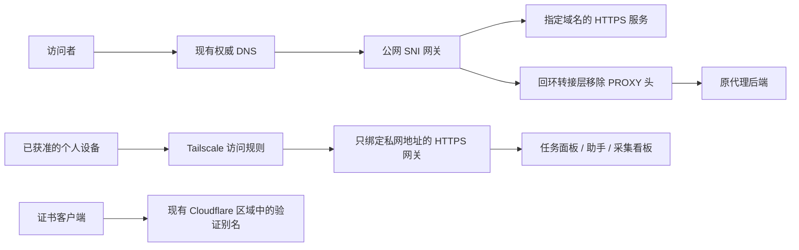

# 服务域名配置实施记录

实施日期：2026-11-17。此文记录本次实际操作及维护边界，真实部署值由受控私有配置保存。登录后功能与订阅来源的遗漏修复见[后续复查](audit-followup.md)。

本文的 IP 证书保留与续期描述属于初次部署阶段；后续代理和面板后端迁移的当前状态见[域名证书迁移](certificate-migration.md)。

部署时产生的回滚备份及临时文件随后已按用户明确要求删除，当前状态见[清理记录](cleanup.md)。文中的部署备份步骤是历史操作，不代表对应副本仍然存在。

## 目标与最终分配

保留三台主机的现有服务，在两台公网主机增加域名 HTTPS 入口，私网主机继续通过 Tailscale 访问。所有面板沿用现有登录保护，订阅沿用原安全路径。

| 角色 | 域名角色 | 服务与访问范围 |
| --- | --- | --- |
| 公网主机 A | `<ROOT_DOMAIN>` | 根域名主页 |
| 公网主机 A | `<API_DOMAIN>` | API、原管理页面及受保护的管理扩展 |
| 公网主机 A | `<PANEL_A_DOMAIN>` | 第一套管理面板，保留原安全路径 |
| 公网主机 A | `<SUBSCRIPTION_DOMAIN>` | 原静态订阅精确路径，以及保留令牌的原生订阅 |
| 私网主机 | `<PRIVATE_HOST_DOMAIN>` | 机器地址，解析到 Tailscale 地址 |
| 私网主机 | `<SCHEDULER_DOMAIN>` | 任务管理页面，需 Tailscale 与应用登录 |
| 私网主机 | `<ASSISTANT_DOMAIN>` | 助手 Dashboard，需 Tailscale 与应用登录 |
| 私网主机 | `<COLLECTOR_DOMAIN>` | 采集看板，需 Tailscale 与原访问认证 |
| 公网主机 B | `<PUBLIC_HOST_B_DOMAIN>` | 机器地址 |
| 公网主机 B | `<PANEL_B_DOMAIN>` | 第二套管理面板及原生订阅，保留原安全路径与令牌 |

## 实际完成的操作

### DNS 与平台

1. 根域名指向公网主机 A，保留私网主机与公网主机 B 的机器地址记录，删除重复的旧机器别名。
2. 添加七条业务 CNAME：公网 API、两套面板、静态订阅，以及三个私网服务。业务别名指向各自的机器地址记录。
3. 添加三条 `_acme-challenge` CNAME，将私网服务的证书验证委托给已有 Cloudflare 区域中的专用别名。
4. 通过公共 DNS 解析器确认新增记录已生效。最终域名平台显示正常、已同步、健康。
5. 权威 DNS 仍由原服务管理。没有把业务域名整区接入 Cloudflare，也没有启用 Cloudflare CDN 代理。

共享公共后缀在不同平台的 PSL 更新状态可能不一致。添加 DNS 记录、域名整区接入 Cloudflare、申请证书是三个独立步骤，不能用其中一个成功推断另外两个已成功。

### 证书与凭据

1. 初次 Let’s Encrypt 签发遇到共享注册域名配额限制。未反复重试消耗配额；依据官方规则核对了等待时间和限制的作用范围。
2. 经用户明确授权，改用 ZeroSSL 免费 ACME 证书，使用获授权的邮箱在三台主机分别注册证书账户。
3. 两台公网主机使用 HTTP-01；私网主机使用 DNS-01，不需要公网监听。
4. 在已有 Cloudflare 区域创建专用 DNS Token，仅允许该区域 DNS 编辑和必要读取。凭据保存在私网主机受控配置中，权限为 `0600`。
5. 使用隔离的测试 ACME 配置完成三个私网域名的验证演练。测试签发成功，临时 TXT 均已清理；测试证书未投入服务。
6. 正式签发并安装三张证书，分别覆盖四个公网名称、三个私网名称和另一套公网面板名称。最终从客户端验证了信任链与主机名，证书有效期至 2027-02-15。
7. 使用证书客户端的安装机制记录 key/fullchain 和重载命令。原有 IP 证书及其签发机构保留。
8. 正常续期检查在三台主机上均成功退出，未强制重签。确认服务器凭据文件权限后，删除本次创建的本地临时 DNS Token 副本。

### 公网主机 A

1. 备份原网关配置、两个 Compose 文件及原 IP 证书续期配置。
2. 将公共 HTTP/TLS 的 TCP 入口交给已有 Nginx 网关；保留原代理 UDP 入口及其他已有监听。
3. 新增 ACME webroot，将原 IP 证书从独占监听验证改为 webroot 验证，避免续期时争抢入口。
4. 使用 SNI 将指定网页域名送到容器内部 TLS 终止端口；其他流量继续进入原代理后端。
5. 为根域名增加静态主页，为 API、面板和订阅增加 HTTPS vhost。复制并保留原管理认证、Cookie 保护、限流和精确订阅 location。
6. 保留原订阅路径、内容和统计 include；没有把订阅目录或根路径公开成列表。
7. 增加证书安装 marker 与宿主 path watcher，证书更新后先执行 `nginx -t` 再 reload；原有续期调度保留。

### 公网主机 B

1. 增加独立 Nginx 网关，加入已有应用网络。先启用 HTTP 验证入口，签发成功后再移交公共 TLS TCP 入口。
2. 只移交需要共享的 TCP 监听，保留原 UDP 代理和原面板入口。
3. 更新原 IP 证书的 webroot 验证方式，并为新面板域名安装独立证书。
4. 新域名仍转发到原面板，安全路径、用户和密码继续由原应用管理。
5. 原 systemd 续期任务同时管理旧 IP 证书与新域名证书，域名证书安装后检查并重载网关。

### 公网来源地址传递

SNI 入口向内部网页监听发送 PROXY protocol；HTTP 层仅信任容器回环来源，恢复实际访问者地址，使网页日志和登录限流按来源地址计算。

原代理后端前增加只监听容器回环的转接层：接收并移除 PROXY protocol 头，再交给原协议后端。没有要求原代理客户端增加该协议头，也没有改动原入站认证。该层不为原代理应用恢复来源地址；网页来源地址和代理应用来源地址须分别理解。

### 私网主机

1. 新增 Nginx 网关，使用 host 网络，只监听 Tailscale 地址上的 HTTP/HTTPS；未在其他公网主机配置私网服务转发。
2. 将三个服务域名转发到各自已有的私网或回环入口；原应用认证保留，反向代理返回的 Cookie 增加 Secure 属性。
3. 增加 DNS 证书签发脚本、凭据文件、证书安装后重载脚本和定时续期单元。
4. 外部验收发现：主机本地 HTTPS 正常，但客户端新端口超时。通过 Tailscale 下发规则确认原策略只允许既有应用端口。
5. 在原有两台获准设备到该私网主机的规则中补充网页访问与跳转端口；来源设备、目标主机和原 SSH 规则保持原范围。
6. 重新读取下发规则并从客户端验证，三个私网域名均可通过可信 HTTPS 到达预期页面或登录跳转。

### 本机代理配置

1. 在全局扩展脚本中，为私网机器名和三个私网服务域名增加精确 `DIRECT` 规则。
2. 将同四个名称加入 Fake-IP 过滤，使其返回真实 Tailscale 地址。
3. 初次部署保留原有规则、过滤项、订阅内容和代理组选择。后续按用户要求，在指定的项目规则文件中加入一条覆盖根域名和全部子域名的后缀直连规则；这次文件修改尚未应用到客户端或远端规则服务。
4. 从系统解析结果确认四个名称均返回私网地址；同时从实际客户端访问验证路由。

### 订阅客户端与保存的登录入口

1. 为现有静态订阅启用域名下载入口，保留原随机路径、查询参数、统计响应头和生成器。
2. 下载旧入口与新入口，确认内容摘要一致；在客户端原订阅配置中修改 URL 并刷新，保留原配置身份、七个节点、更新选项和覆写规则。
3. 将原有受控订阅地址备忘文件同步到新 URL。旧地址仍保存在私有部署映射中，便于回滚。
4. 用户确认 Chrome 密码只保存在本机，并选择自行按清单修改。已交付六类服务的私有地址映射及[操作步骤](browser-logins.md)，包含两套面板的所有已保存账号；未读取密码库或修改账户、密码。
5. 用户确认另一套面板的登录条目和订阅内节点地址都需要迁移。为目标静态订阅的两条节点增加持久 `server_overrides`，按完整节点名称及预期原地址匹配，只替换连接地址。
6. 保留原端口、SNI、认证与协议参数，确认目标域名解析到原主机。生成器遇到缺失节点、意外地址变化或 TLS 节点未显式设置 SNI 时停止发布；仍适用原有失败回退和过期撤下规则。
7. 备份原生成器及私有配置后部署更新，正常刷新任务成功，定时器保持启用。使用同一份上游输入比较旧、新生成结果，域名迁移只改变目标节点的两个 `server` 字段。外部提供方正常更新附加节点的混淆域名时，继续沿用原有刷新行为。
8. 电脑操作工具持续报告上一会话的锁定状态，用户解锁及重新建立控制连接后仍不可用；由用户在客户端点击刷新。随后读取订阅文件和生成配置，均确认两条域名节点已更新，总数仍为七个。

密码管理器迁移应仅更新对应网站地址并保留原账号和密码。完整旧入口与新入口只保存在 `.private/deployment.json` 和 `.private/password-manager-migration.json`，不写入公开文档。用户按清单操作后的自动填充与登录尚未验收。

### 管理扩展打不开的后续修复

用户反馈管理中心正常、Keeper 无法打开。浏览器复现显示：管理中心的插件资源页已使用新域名，但内部 iframe 仍引用旧地址，被现有同源保护拒绝。另一个独立检查发现，新域名专用入口的重定向会把内部 TLS 监听端口带入 `Location`。

原因是迁移时复制了旧路由和认证规则，却遗漏插件的绝对入口 URL 及新 vhost 的重定向端口设置。前一阶段只验收了匿名拒绝和基础页面可达，没有走登录后的嵌入链路，因此未发现这两处问题。

修复与验证：

1. 备份现有网关与应用配置，将插件 `keeper_url` 的来源改为管理中心的新域名，保留原安全路径，通过管理界面保存，并核对运行配置已落盘。
2. 在公网主机 A 的四个新域名 vhost 中增加 `port_in_redirect off`，先执行 `nginx -t` 再平滑重载。该设置只作用于新域名 server，不放到包含旧入口的全局 HTTP 配置中。
3. 同步修正 `public-vhost.conf.template`。未修改账户、密码、Cookie 校验、`SameSite`、`X-Frame-Options` 或 `frame-ancestors` 保护。
4. 原生 Nginx 回归测试先在旧模板上复现内部端口泄漏，修复后通过；同时断言旧监听仍保留其必要端口。测试只使用回环临时端口和合成证书，结束后删除临时容器。
5. 线上专用入口返回正常重定向，最终应用 HTTP 200；匿名应用与插件资源入口仍返回 HTTP 404。Chrome 中已实际打开 Keeper，概览与已有用量数据正常加载。
6. 初次检查另一台公网主机时，完整面板入口返回 HTTP 200，补尾斜杠返回相对重定向，没有暴露内部端口。后续为其补充原生订阅路由时，同时设置新域名的 `port_in_redirect off`。私网网关直接监听外部使用的私网 HTTPS 端口，不存在该 SNI 内部端口条件。

此插件版本要求绝对应用根 URL，校验逻辑见[官方源码](https://github.com/Willxup/cpa-plugin-usage-keeper/blob/v0.1.0/plugin.go#L177)。Keeper 的规范入口是新域名管理中心中的侧栏链接；直接匿名访问应用路径返回 HTTP 404 属于原保护机制。在旧地址的管理页内嵌入新域名也会受到同源限制，应改用新域名管理中心。

离线工具测试 12 项通过。原生回归测试另行运行 1 项通过；默认未指定镜像时会跳过，不能把跳过记作通过。运行命令：

```sh
DOMAIN_GATEWAY_NGINX_IMAGE='<INSTALLED_OFFICIAL_NGINX_IMAGE>' \
  python3 -m unittest discover -s script/domain-gateway -p 'test_nginx_redirects.py' -v
```

实际修复和验收脚本保存在本地受控 `.private/rollout/` 中，线上回滚备份后续已按用户要求删除。此次未改动 Keeper 的业务设置，也未验收修改凭据、价格或清理业务数据等写入操作。

## 架构



业务访问不会经过 DNS 验证别名。Cloudflare Token 用于添加和删除验证 TXT；私网浏览器请求仍经 Tailscale 直达私网网关。

## 部署与回滚要点

1. 先核对 DNS、监听占用、应用认证、容器网络和证书续期方式，保存原配置及权限。
2. 先检查 Compose 与 Nginx 候选配置；验证 webroot 能从外部读取，再申请公网证书。
3. 证书实际安装后再启用 TLS vhost。新增挂载需要容器重建，不能只 reload。
4. 移交公共 TCP 入口时，先移除原容器的对应发布，再启动网关。原 UDP 映射必须保留。
5. 回滚时先恢复网关以释放接管的入口，再恢复原容器发布；同时恢复原验证方式和配置文件。
6. 不要关闭旧入口或修改原订阅安全路径来“简化”切换。管理扩展与订阅响应头必须随原 location 保留。
7. SSH 中断后先读取部署状态、文件和实际监听，再决定重试；不能把未收到输出当成“没有执行”。本次中断重试前均完成了状态核对。
8. 一次性脚本包含阶段检查和回滚逻辑，不应在已完成环境中直接重跑。原回滚备份已在后续清理中删除；恢复前必须先确认现存材料，业务数据继续保留。
9. 只回滚节点域名时，恢复迁移前的订阅生成私有配置或移除对应 `server_overrides`，重新生成并刷新客户端。不要手改输出 YAML；订阅下载域名与节点地址是独立设置。

## 验证记录与边界

| 检查 | 结果 |
| --- | --- |
| 新业务 DNS 与验证别名 | 已验证 |
| 两台公网 HTTP 验证入口 | 从客户端读取成功 |
| 私网 DNS 测试签发与 TXT 清理 | 已验证 |
| 三张正式证书的客户端信任与名称 | 已验证 |
| 根域名主页 | HTTP 200 |
| 公网 API 未认证请求 | HTTP 401 |
| 受保护管理扩展的匿名访问 | HTTP 404 |
| 管理扩展的登录后嵌入 | 后续修复后在 Chrome 中正常显示概览及已有数据 |
| 两套面板的原安全入口 | 登录页面 HTTP 200；后续已读取登录后的运行状态和已有数据 |
| 静态订阅原安全路径 | 返回内容与当前发布文件一致，根路径不公开 |
| 私网任务面板 | HTTP 200，登录后的任务列表可读取 |
| 私网助手与采集看板 | 后续已验证登录后的现有内容；看板分页修复结果见后续复查；未认证 API 仍拒绝 |
| 私网监听与访问来源 | 仅 Tailscale 地址；仅原两台设备获准访问网页入口 |
| 本机私网 DNS | 四个名称均非 Fake-IP |
| 公网主机 A 原有代理 | 两条 VLESS 与一条 Hysteria2 实测可用 |
| 公网主机 B 域名节点 | 使用现有 DNS 上游的隔离测试中 VLESS 可用；Hysteria2 的原有连通问题仍存在 |
| 三台证书正常续期检查 | 均退出成功；未强制重新签发 |
| 客户端订阅切换 | 原订阅配置已更新并刷新，七个节点保留 |
| 项目 HTTPS 验收脚本 | 八个入口全部通过可信 TLS 与预期响应检查 |
| 参数化工具测试 | 12 项通过 |
| 域名重定向原生回归 | 旧模板可复现，修复后 1 项通过；旧监听端口行为保留 |
| 静态订阅生成器测试 | 45 项通过，包含域名迁移、源漂移拒绝、参数保留和失败回退 |
| 节点域名发布与客户端刷新 | 两条节点已使用域名；订阅文件与生成配置均已核对 |
| 配置模板检查 | 11 个模板成功渲染；公网与私网 Compose/Nginx 原生检查均通过 |
| 域名平台 | 最终显示健康 |

独立节点测试使用隔离配置和物理网卡，测试进程随后退出；未变更正在使用的客户端代理选择。直接通过 TUN 发起的独立 UDP 测试会受到二次转发影响，因此不能直接据此判定服务器故障。

模板原生检查在无网络、未发布端口的临时容器中运行，使用示例地址和临时自签名证书，未装载线上私钥或替换生产配置。私网模板需要测试网络允许绑定示例地址；该设置只作用于临时容器。

后续已补充实际登录后的页面、应用内链接和订阅输出检查，但没有重新验证所有写入业务操作，也没有在移动设备上重新验收。现有代理故障不属于本次域名配置的修复范围，不能用域名证书正常推断代理协议全部正常。本机到公网入口仍曾出现间歇 TLS 失败，详见后续复查。

## 代码与资料保存

- [维护工具与模板](../../script/domain-gateway/README.md)：可跟踪的参数化源码、示例配置和测试。
- 项目工具目录的 `.private/deployment.json`：受权限保护的真实部署映射，由 Git 忽略。
- 同目录的 `.private/rollout/`：本次实际使用的一次性脚本，由 Git 忽略。此目录不收集 DNS Token、证书私钥或服务器凭据文件。
- 服务器现有配置、证书与认证资料继续保留在原受控位置；原回滚备份已按用户要求删除。记录中的占位符从未写入运行环境。
- 仓库内新增工具是维护源码，现有线上续期任务仍沿用本次已配置的原生 ACME/定时器方式，未另外启用重复调度。
- 同步根目录索引、助手后台、采集看板和静态订阅的访问说明。后续还替换助手上游 URL，并保存看板分页时限补丁；保留原模型、凭据和业务数据。
- 公开文档、示例及模板使用占位符；用户指定的实际运行规则保留必要的部署值，不将占位符写入运行环境。所有变更仍在本地工作区，未提交或推送。

Chrome 条目由用户按清单在本机修改，自动填充与登录待用户确认。原有代理连通问题单独保留，未记为本次已修复。

## 后续运维

改动域名时同时检查 DNS、证书 SAN、SNI 映射与 vhost。改动私网域名还需检查客户端精确直连规则及 Fake-IP 过滤。新增私网设备应单独授权，不能把当前规则改为整个网络均可访问。

更换 DNS Token 后，使用隔离测试 ACME 目录验证写入和清理，再检查正式续期任务。不要为测试强制重签所有证书。原证书签发机构和账户信息以各证书私有配置为准。

参考：[acme.sh DNS alias mode](https://github.com/acmesh-official/acme.sh/wiki/DNS-alias-mode)、[Let’s Encrypt 配额](https://letsencrypt.org/docs/rate-limits/)、[ZeroSSL ACME](https://zerossl.com/documentation/acme)。
