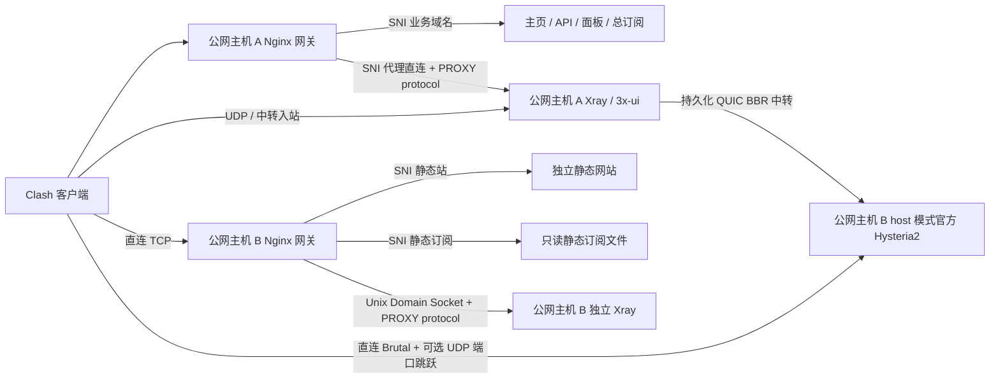

# 公网代理主机性能调优与落地架构简化记录

实施日期：2026-11-27。承接[服务域名配置实施记录](implementation.md)、[域名证书迁移](certificate-migration.md)与[独立静态网站部署记录](standalone-site.md)。

本文仅记录通用架构、内核与服务调优方法、验证结论与运维边界；真实服务器地址、域名、供应商、地域、接入端口、SSH 别名、账号标识、订阅地址、凭据、部署路径及套餐配额只保存在受控私有配置中，不写入公开文档。

## 背景与诊断发现

对两台公网代理主机（公网主机 A：优化回程线路、承担主控面板、API 网关与总订阅入口；公网主机 B：常规回程线路、国际带宽充裕但晚高峰直连丢包严重、承担独立落地与静态站点）开展全栈排查，确认以下核心瓶颈与隐患：

1. **UDP 内核缓冲区过小导致真实丢包**：两台主机 `net.core.rmem_max` 与 `net.core.wmem_max` 均为默认 208 KB，公网主机 A 代理容器的 `/proc/net/snmp` 已累计超过 5.2 万次 `UdpRcvbufErrors`，严重压低 QUIC / Hysteria2 直连及跨机中转吞吐。
2. **网关长连接与高频重载冲突导致 OOM**：公网主机 A 的 Nginx 网关同时承载长连接代理分流（`stream` 模块）与静态订阅分发；静态订阅定时器每 15 分钟无条件执行 `nginx -s reload`，加之未配置 `worker_shutdown_timeout` 且残留旧版每日重载定时器，大量 `worker process is shutting down` 跨天积压，已触发过容器 cgroup OOM 强杀。
3. **公网主机 B 并发与内存双受限**：容器默认 `ulimit -n` 仅 1024、`nf_conntrack_max` 仅 8192、`tcp_max_tw_buckets` 仅 5000；且在不足 1 GB 内存的主机上为单一落地用户运行了一整套面板容器（面板进程独占超 100 MiB），叠加邮件代理、无线管理、云厂商监控代理及未设上限的 `systemd-journald`，可用内存长期偏紧。
4. **回环双跳转发与公网裸露旧端口**：两台网关均通过本地回环转接层剥离 `PROXY protocol`，单条代理连接占用双倍连接槽与额外拷贝；两台主机在完成域名迁移后仍残留旧面板、旧原生订阅及旧 API 端口暴露在公网，持续收到扫描探测。
5. **伪装与配置细节**：Hysteria2 伪装指向外部站点，与同域名 TCP 静态主页响应不一致；两台均使用默认高频 Reality 目标；公网主机 A 的直连出站缺少解析后私网地址拦截与纯 IPv4 策略；Clash 自动选择组 `interval: 30` 且 `lazy: false`，待机期间仍高频心跳探测。

## 目标架构

- **公网主机 A（唯一控制面 + 主力直连 + 中转入口 + API 服务）**
  - 保留唯一一套管理面板、唯一静态总订阅入口（继续合并主用节点、落地直连节点、服务端中转节点及既有附加外部节点）、API 代理与用量扩展。
  - 公网 TCP 仅保留标准管理、HTTP 验证、标准 HTTPS 与既有服务端中转端口；管理面板、原生订阅与 API 全部收敛至标准 HTTPS 域名入口。
  - 保留用户的账号、额度、重置周期与双节点范围保持不变，仅改用标准 HTTPS 订阅域名入口。
- **公网主机 B（极简纯落地 + 独立静态站）**
  - 下线冗余管理面板，替换为两个极轻官方内核容器：独立 `xray-core`（负责直连 VLESS，经 Unix Domain Socket 对接网关）与 `network_mode: host` 的官方 `hysteria` v2 服务端（直绑主机网卡绕开 Docker 网桥与 NAT，同一入口自动对无带宽参数的中转客户端使用 BBR、对携带带宽参数的直连客户端使用 Brutal）。
  - 原独立静态网站保持原样运行；原域名下的订阅路径改为由网关直接托管只读静态订阅文件，消除面板攻击面并兼容直连拉取。



## 实际实施的变更

### 1. 内核网络栈、网卡与容器并发调优

- **公网主机 A** 新增 `/etc/sysctl.d/99-z-proxy-tuning.conf`：
  - `net.core.rmem_max = 16777216`、`net.core.wmem_max = 16777216`、`net.core.rmem_default = 1048576`、`net.core.wmem_default = 1048576`
  - `net.ipv4.tcp_rmem = 4096 131072 33554432`、`net.ipv4.tcp_wmem = 4096 65536 16777216`
  - `net.ipv4.tcp_slow_start_after_idle = 0`、`net.ipv4.tcp_mtu_probing = 1`、`net.ipv4.tcp_fastopen = 3`、`net.ipv4.tcp_notsent_lowat = 16384`、`net.ipv4.tcp_max_syn_backlog = 4096`、`net.core.netdev_max_backlog = 8192`、`net.core.somaxconn = 8192`
  - 新增持久化 systemd 单元开启网卡 UDP GSO（`tx-udp-segmentation on`）并将 `fq` 队列调整为 `limit 20000 flow_limit 2000`，消除 `flows_plimit` 丢包。
- **公网主机 B** 新增 `/etc/sysctl.d/99-z-proxy-tuning.conf`（按小内存规格收口）：
  - `net.core.rmem_max = 8388608`、`net.core.wmem_max = 8388608`、`net.ipv4.tcp_rmem = 4096 131072 16777216`、`net.ipv4.tcp_wmem = 4096 65536 16777216`
  - `net.netfilter.nf_conntrack_max = 32768`、`net.ipv4.tcp_max_tw_buckets = 32768`，同步应用 `tcp_slow_start_after_idle = 0`、`tcp_fastopen = 3`、`tcp_notsent_lowat = 16384`。
  - 在 `/etc/docker/daemon.json` 配置 `default-ulimits.nofile` 为 `65535`，重启 Docker 使容器文件描述符上限从 `1024` 提升至 `65535`。
- **公网主机 B 宿主机瘦身**：停用并禁用无用的邮件代理、无线/蜂窝管理服务与云厂商常驻监控代理（保留实际管理主网卡 DHCP 的 `NetworkManager`）；为 `systemd-journald` 配置 `SystemMaxUse=40M` 与 `RuntimeMaxUse=15M`。

### 2. 公网主机 A 网关止漏、去双跳与端口收口

- **解决 worker 泄漏与 OOM**：
  - 网关 `nginx.conf` 增加 `worker_shutdown_timeout 60s;` 并将 `worker_connections` 提升至 `4096`。
  - 静态订阅定时器刷新间隔由 `15min` 调整为 `2h`，对应放宽私有配置中的 `max_stale_seconds` 至 `21600`。
  - 优化[静态订阅生成器](../../script/clash/static-subscription/generate.py)：发布新代时比对上一代 `headers.conf`，仅当响应头内容实际发生变化时才执行 Nginx 校验与重载，并补充对应单元测试。
  - 停用已冗余的旧版每日网关强制重载定时器，保留按证书摘要变更触发的热载定时器。
- **消除回环双跳**：
  - 面板主 TCP 代理入站启用 `tcpSettings.acceptProxyProtocol = true`（Reality `xver` 保持 `0`）；网关 `stream` 默认分支直接转发至代理后端，移除本地回环转接层。
- **代理安全与伪装加固**：
  - 直连出站补充 `finalRules`（拦截 `geoip:private`）及 `streamSettings.sockopt.domainStrategy = "UseIPv4"`；服务端中转 Hysteria2 出站显式配置 `quicParams`（BBR `aggressive`）；面板 `trustedProxyCIDRs` 补充网关容器网段。
  - 将本地静态主页目录只读挂载至代理容器，Hysteria2 伪装由外部反代改为 `type: "file"`，保证同域名 TCP 与 UDP 响应一致；Reality 目标更换为低延迟、无内核告警的常规 TLS 1.3 + H2 目标。
  - 关闭面板容器内重复的 fail2ban 并移除 `NET_ADMIN`/`NET_RAW` 权限；为面板容器与 API 代理容器分别配置 `mem_limit: 512m`。
- **公网端口收口**：移除网关与面板的旧面板端口、旧订阅端口和旧 API 端口映射，清理 API 虚拟主机中重复挂载的静态订阅路径，同步收紧宿主机防火墙白名单。

### 3. 公网主机 B 去面板与纯内核落地改造

- 备份原面板配置与数据库后，停止并移除公网主机 B 的面板容器（原数据库与证书目录保留冷备，不破坏 ACME 账号与续期目录）。
- 在 `<LANDING_PROXY_DIR>` 部署两个独立官方容器（内存上限均设为 `128m`）：
  - **独立 `xray-core` 容器**：以镜像非 root UID 权限收口配置文件，监听共享目录下的 `<UNIX_SOCKET_PATH>` 并开启 `acceptProxyProtocol = true`，使用低延迟且无告警的独立 Reality 目标；配置 `sniffing.routeOnly = true`、`direct` 出站 `finalRules` 与 `sockopt.domainStrategy = "UseIPv4"`。
    - **排查修复**：初始配置将云内网递归 DNS 直接写入 `dns.servers` 时，因内网 DNS 落在 `geoip:private` 范围而被 Xray 自身路由规则拦截导致首包超时约 9 秒；改为 `"servers": ["localhost"]`（走系统宿主机内网解析器并绕开 Xray 自身路由）并保留 `queryStrategy: "UseIPv4"` 后彻底消除超时，同时保留毫秒级本地解析。
  - **官方 `hysteria` v2 容器**：采用 `network_mode: host` 直绑标准 UDP 入口，复用既有域名证书与认证凭据，使用本地静态页伪装；配置大 QUIC 接收窗口（单流 8 MB / 连接 20 MB）、开启 PMTUD（`disablePathMTUDiscovery: false`），并结合实测的持续出口带宽上限将服务端 `bandwidth` 精准设为匹配值（`ignoreClientBandwidth: false`），使服务端中转自动协商 BBR、直连客户端按需协商 Brutal；ACL 显式拦截私网与 SMTP 25 端口。
- **UDP 端口跳跃**：新增持久化 systemd 单元在宿主机 `nat PREROUTING` 将 `<UDP_HOP_RANGE>` 重定向至标准 UDP 入口，配合云安全组入方向放行已完成随机跳跃端口端到端实测验证。
- **静态订阅传输参数注入**：在[静态订阅生成器](../../script/clash/static-subscription/generate.py)中新增白名单校验字段 `node_options`，在主用户静态总订阅中为落地 Hysteria2 节点注入 `ports`、`hop-interval`、贴合实测上限的 Brutal 带宽参数与 `obfs`/`obfs-password`（Salamander 混淆），并为 VLESS 节点启用 `packet-encoding: xudp`（不触碰任何凭据或保留用户订阅）。
- **Hysteria2 Salamander 混淆**：针对 QUIC 明文 SNI 触发中间设备伪造回包导致握手超时的问题，为公网主机 A 入站（`finalmask.udp`）、公网主机 B 落地（`obfs.salamander`）以及主机 A 指向主机 B 的中转出站均启用各自独立的 Salamander 混淆密码（仅存私有配置），并同步更新静态订阅与原始订阅输出，实现全链路零伪造包干扰。
- **网关与证书热载衔接**：
  - 公网主机 B 网关同样添加 `worker_shutdown_timeout 60s` 与 `worker_connections 4096`，移除回环双跳，将默认流量直接通过 `unix:<UNIX_SOCKET_PATH>` 送往 `xray-core`；保留独立静态站点配置不变。
  - 原面板域名去除面板反代（根路径返回 404），仅在原随机路径下托管只读静态原始订阅与 Clash 订阅文件，并移除公网旧面板/订阅端口。
  - 更新证书自动热载脚本与配置，使定时续期后校验并重启官方 Hysteria2 容器并重载网关，避免等待已下线的面板进程。

### 4. Clash 规则、广告规则集与客户端 DNS 优化

- **消除规则链不必要的本地 DNS 触发**：
  - 在 [dmit-rules.yaml](../../config/clash/dmit-rules.yaml) 中为 `GEOIP,private,DIRECT` 补齐 `,no-resolve`，并在 `GEOSITE,CN,DIRECT` 与 `GEOIP,CN,DIRECT` 之间插入 `GEOSITE,geolocation-!cn,PROXY`，避免常规国内外域名在 `fake-ip` 模式下被提前触发跨代理 DoH 解析，由远端出口就近解析海外域名。
  - 清理被 `GEOSITE,CN` 覆盖的重复国内 `GEOSITE` 条目，保持规则精简。
- **拆分广告规则集（Trie 匹配 + `no-resolve`）**：
  - 将 [广告规则更新脚本](../../script/clash/update-johnshall-shadowrocket-ad.sh) 与定时工作流改为生成两份独立规则集：`behavior: domain`（`+.domain` 文本格式，走域名 Trie 树，零 DNS 触发）和 `behavior: ipcidr`（规则处带 `,no-resolve`，仅匹配纯 IP 连接），替代原先 5.4 万条混合 `classical` 规则集。
- **调整 `Auto` 为稳定优先的 `fallback` 策略**：
  - 因 Mihomo `include-all-proxies` 按名称字母序排序，在 [dmit-rules.yaml](../../config/clash/dmit-rules.yaml) 中引入两个隐藏筛选辅助组（`Auto-Vless`、`Auto-Hysteria2`）供 `Auto`（`type: fallback`、`interval: 180`、`lazy: true`）按顺序编排，实现日常优先走更稳定的 VLESS、故障时自动切换 Hysteria2，且继续只对外展示单一 `PROXY` 选择组并兼容仅含双节点的保留订阅（规则改动需推送至远程仓库默认分支后由面板在线规则拉取生效）。
- **精简客户端 DNS 配置**：
  - 更新 [dmit-client.yaml](../../config/clash/dmit-client.yaml)：移除 `direct-nameserver` 中易劫持/偏慢的上游并统一为两家国内 DoH，移除 `default-nameserver` 慢节点与 `nameserver` 第三家冗余 DoH，补充 `nameserver-policy`（国内与私网域名走国内 DoH）以及 macOS NTP、WebRTC STUN 等常见 `fake-ip-filter` 条目。
- 触发静态订阅生成器发布新版本，确认主用户唯一总订阅保持 7 个节点（含两台主机直连节点、服务端中转节点与两个既有附加外部节点），保留用户原生 Clash 订阅仍仅含公网主机 A 的 2 个节点且凭据与额度未变。

## 验证结果与关键数据

| 验证项 | 改造前 | 改造后实测结果 |
| --- | --- | --- |
| 公网主机 A UDP 缓冲丢包 (`UdpRcvbufErrors`) | 累计 52,038 次丢包（208 KB 缓冲） | 20 MB 连续压测后新增 **0 次**（16 MB 缓冲） |
| 公网主机 A 网关 worker 与内存 | 12 个僵持 worker / >135 MiB，曾 OOM | **1 个活跃 worker / ~5–9 MiB** |
| 公网主机 A 容器内存与端口 | 面板 174 MiB、暴露 3 个旧管理/订阅端口 | 面板 ~67 MiB，公网仅留标准管理/HTTP/HTTPS/中转口 |
| 公网主机 B 容器 `ulimit -n` 与可用内存 | `ulimit -n = 1024`，可用内存 431 MiB | `ulimit -n = 65535`，可用内存 **~586 MiB**（代理双容器合计 ~25 MiB） |
| 公网主机 B 端口与证书自动热载 | 公网暴露旧面板/订阅口 | 公网 TCP 仅留标准管理/HTTP/HTTPS；强制热载演练返回 `reloaded` |
| 5 条自有节点端到端连通与出口 | — | 全部通过独立客户端隔离测试，出口地域与 TLS 1.3 均符合预期 |
| 吞吐实测（20 MB 单流下载） | 中转与 UDP 受 208 KB 缓冲压制 | 主机 A 直连 200–314 Mbps；经主机 A 中转至主机 B 跑出 **~99% 主机 B 出口带宽上限**；修复 `localhost` DNS 后直连 TCP 首包与吞吐恢复正常 |
| 离线回归测试 | — | 静态订阅单测 47 项通过（含 `node_options` 与未变更跳过重载）；Clash 离线路由回归 12 项通过 |
| 端口跳跃与 Salamander 混淆实测 | 单端口 UDP 易受限速；明文 QUIC SNI 触发伪造回包超时 | 主机 A/B 直连与中转三条链路均 100% 连通，伪造包命中 **0 次**；随机跳跃端口跑满主机 B 持续出口上限 |

## 运维与回滚要点

- 两台主机完成端到端验收后，已停用冗余宿主机守护进程并清理本轮优化产生的临时备份与旧版未使用镜像，同时完整保留证书、ACME 续期状态、现网凭据与公网主机 B 的旧数据库冷备。
- 静态订阅生成器测试命令：

```sh
python3 -m unittest discover -s script/clash/static-subscription -p 'test_*.py' -v
```

- Clash 路由离线回归测试命令：

```sh
ruby script/clash/test-dmit-routing.rb
```

- 本次调整了 Reality 目标、公网旧端口与落地端口跳跃参数，客户端刷新唯一总订阅即可生效；保留用户切换至标准 HTTPS 订阅域名并刷新一次。
